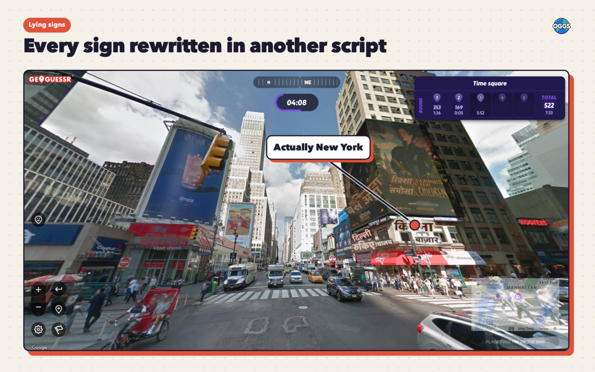
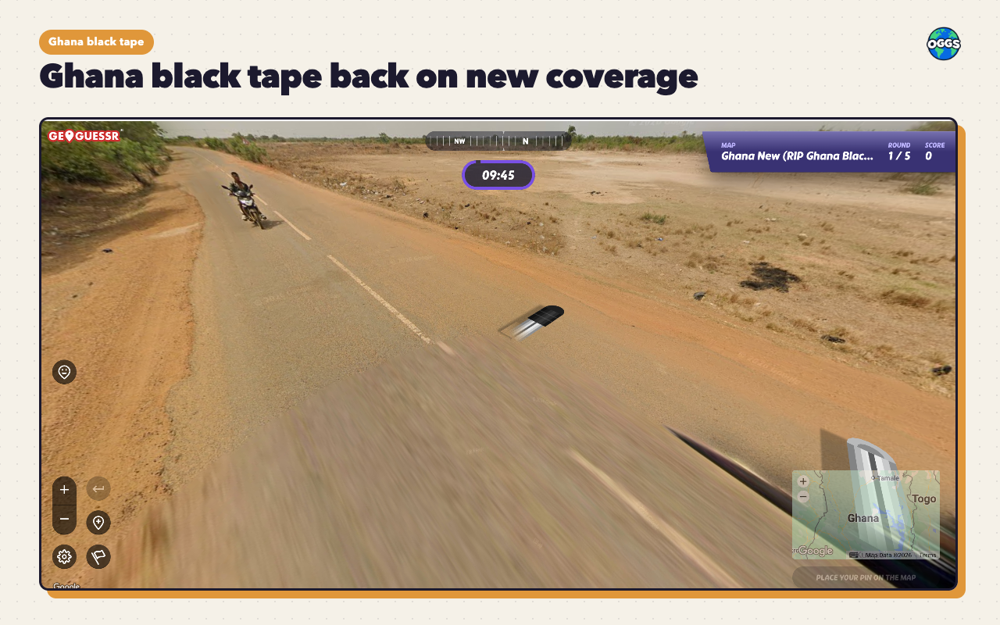
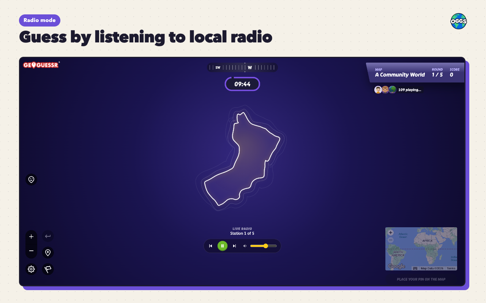

# OGGS: Orlando's GeoGuessr Scripts

> **Status:** a fun side project, maintained now and then. Live on the Chrome Web Store and as a Tampermonkey userscript. Made for singleplayer and games with friends; every script switches itself off in ranked and competitive modes.

A browser extension that bundles a few GeoGuessr scripts. Turn each one on or off from the toolbar popup.

## Install

**Easiest: the Chrome extension.** Works in Chrome, Edge, Brave, Opera and other Chromium browsers.

→ [OGGS on the Chrome Web Store](https://chromewebstore.google.com/detail/oggs-orlandos-geoguessr-s/lbnadihehgfemijnjmabooamfnppkkpa)

Switch scripts on and off from the OGGS icon in the toolbar, or on geoguessr.com from the yellow **OGGS** tab at the bottom left (or **Alt+O**, Option+O on a Mac). Both show the same settings. Recording? Tick *Hide OGGS tab* and use the shortcut.

**Otherwise: the userscript.** For Firefox, or if you already use Tampermonkey.

> Note: the userscript needs a userscript manager such as [Tampermonkey](https://www.tampermonkey.net/). In Chromium browsers (Chrome, Opera, Edge, Brave…) Tampermonkey also needs your browser's Developer Mode switched on. The toggle is at the top right of `chrome://extensions`.

1. Install Tampermonkey (or Violentmonkey).
2. Open [oggs.user.js](https://raw.githubusercontent.com/Orlando-PB/OGGS/main/userscript/oggs.user.js) and click **Install**.
3. On geoguessr.com, settings are behind the yellow **OGGS** tab at the bottom left, or **Alt+O** (Option+O on a Mac).

Updates come automatically in both cases.

## Scripts

The settings open with a search box (type a modifier's name); each section lists its scripts A to Z.

### Chaos mode

GTA-style: every so often (10 s to 2 min, default 30 s; the first 3 s into each round) a random script switches on with random settings for 30 s, so at short intervals several run at once. A small panel on the left (drag it anywhere) shows the time to the next effect and what's on. A new round starts clean. Scripts that fight over the same thing never run together. A drawing board is rare (about once a game), lasts the rest of the round, takes your guess off the map and ends the effects that need the map. Extra guesses leaves your closest pin as the guess when it runs out. Map hints lie half the time, like Terrible hints (which chaos leaves out for that reason), and each hint has its own colour and label. Slow effects (ASCII cam, Colour filter, Minecraft world) get ready before their turn, so they switch on and off at once; Minecraft is never the first effect of a round. Untick effects under *Effects* (Blank screen starts unticked). Scream to look and Speech jammer need the microphone, which chaos asks for when it starts; without it they're left out and a warning offers to ask again. Neither can be switched on anywhere while the microphone is blocked. While chaos is on, the other scripts are paused; No move, pan, zoom, Clean map and the OGGS tab still work.

### Guessing

**Draw your country.** Replaces the guess map with a drawing board. Sketch the country you think you're in and pin your spot; it snaps to the closest real country, then zooms out to where you really were, with the real country outlined if you missed.

**Draw the flag.** Replaces the guess map with a paint board. Paint the flag of the country you think you're in, then click your spot in the outline of the country whose flag it matched (by default the guess has to go inside it), and it zooms out to where you really were.

**Show latitude, Show longitude.** Shades a band the round is somewhere inside, from exact to a hemisphere.

**Show area.** One slider from the continent, through 5 down to 1 countries (the right one among decoys), to a circle of 2500 down to 5 km radius.

**Extra guesses.** Drop several pins; when you guess, the closest one counts.

**Show distance.** Each pin you drop shows how far it is from the spot, in kilometres or miles.

**Terrible hints.** Each round shows one random hint (a latitude or longitude band, or an area, at a random size); half the time it's made up. Once you guess (or the round ends), a hint that lied says so on the map, results screen included ("Area was a lie"); this goes for the hints chaos turns on too.

**Wobbly pin.** Your pin lands somewhere random near where you click, up to 2500 km away.

**Ocean only.** You can only guess in the ocean.

**Guess in a country.** The guess map shows one country (Australia unless you pick another, or a random one each round) with the rest of the world greyed out, and the whole world squashed into it: the Americas in the west, Asia in the east, the far north along the top. Pin a spot in the country and the guess goes to the place in the world it stands for. You can still zoom and pan, but clicks outside the country don't count. Small far-off islands are left out. The squashed world's outlines can be switched off.

**Blind map.** The guess map goes blank.

**Drifting map.** The guess map keeps sliding about, and you can't zoom it.

### Street View

**Spinning view.** Street View slowly spins.

**ASCII cam.** Street View drawn in text characters, black and white or in colour.

**Minecraft world.** Redraws the round in Minecraft. Switches on No move, since every new view is a fresh generation; a few high-quality rounds a day.

**Lying signs.** Rewrites the text on Street View signs in another script (Thai, Korean, Cyrillic and more), another language, or Minecraft's enchanting-table glyphs.

**Senegal gradient.** Street View melts into a colour gradient.

**Ghana black tape.** Adds Ghana's black tape to new Gen 4 coverage, or with *Add to all rounds* to every round anywhere (what chaos uses).

**Colour filter.** Black and white, inverted, or black and white with one colour kept (red, orange, yellow, green or blue).

**Flipped view.** Street View mirrored or upside down.

**Partial view.** You only see part of Street View: a half, the centre, a spyglass, a strip, a corner, or a window bouncing round like the old DVD screensaver.

**Blank screen.** Blacks out everything but the guess map.

**Blink.** Street View only shows for a moment each round, from 10 s down to 0.1 s.

**Compass lock.** Stuck facing north, east, south or west.

**Max zoom.** Street View is stuck fully zoomed in.

**Scratch card.** Scratch away foil to see Street View, while your scratching lasts.

### Misc

**Radio mode.** Hides Street View; you guess from a live radio station near the round's location.

**Scream to look.** Street View only opens when you make noise into your mic. Sound is only measured, never recorded or sent.

**Speech jammer.** You hear your own voice loud and 200 ms late (the delay studies found hardest to talk through), which makes talking hard. Quiet static underneath stops you hearing your own voice normally. Wear headphones (closed-back work best), or it howls. Your voice only passes through the page, never recorded or sent.

**Lag.** A terrible connection: spinners, loading bars that slip back, blocky tiles, freezes that replay your input all at once, rubber-banding, slow guesses, a pin that follows your cursor off the map. One slider from a bit annoying to nearly unplayable.

### Controls

**No move, pan, zoom.** Your own NMPZ rules on any game, each of the three separately. In a friendly duel one of you can play NMPZ while the other moves freely.

**Inverted controls.** Your controls go the wrong way.

### UI

**Clean map.** Hides the Terms, Map data and Keyboard shortcuts strips and the Google logo; optionally the GeoGuessr logo and the scoreboard too.

All scripts switch off in competitive modes. They're for fun, not for cheating.

## Privacy

Everything runs in your browser. What does leave the page:

- **Minecraft world:** the panorama id and size, a random per-install id for the daily count and your code (if you entered one) go to `oggs.orlandopb.com`, which fetches the panorama and calls the image API with its own key. The server keeps the time, that id and your IP address for two days, for the daily limits only.
- **Radio mode:** the round's coordinates go to [radio-browser.info](https://www.radio-browser.info) to find stations; the audio streams from each station's own server.
- **GeoGuessr's own API** (with your existing session) is read to tell the game mode, map and round, so scripts can switch off in competitive games.
- **Userscript only:** the drawing boards, the country outlines (Area, Ocean only, Guess in a country, Terrible hints) and the sign-text detector are loaded from `oggs.orlandopb.com`.

*Scream to look* asks for your microphone; it only measures loudness in the page.

Nothing about you or your account is sent anywhere else.

## Help

Something broken? [Open an issue](https://github.com/Orlando-PB/OGGS/issues).

## Credits

Developed by Orlando. AI-generated code assisted with this project.
