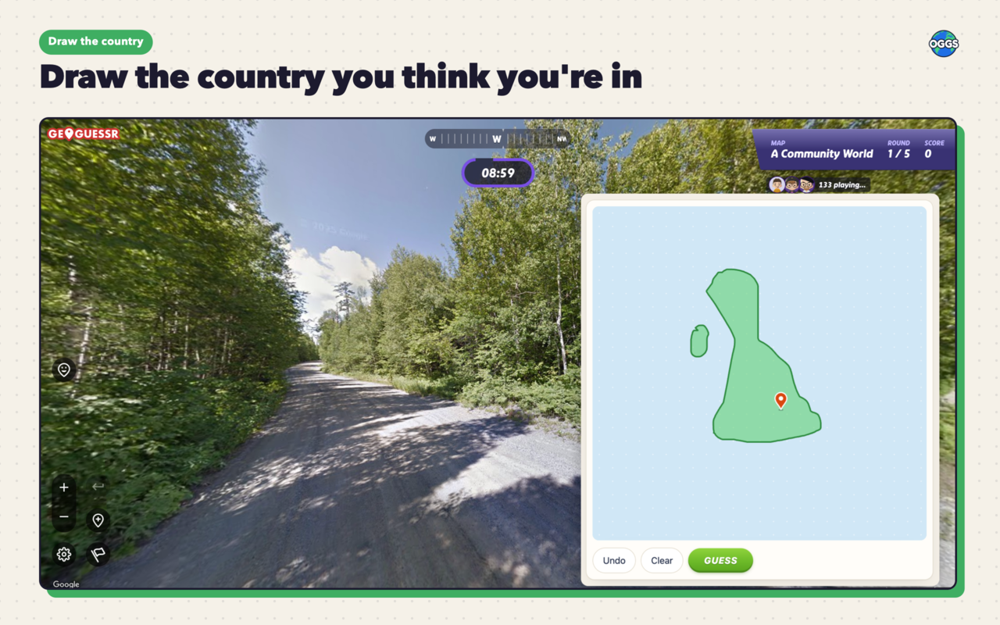
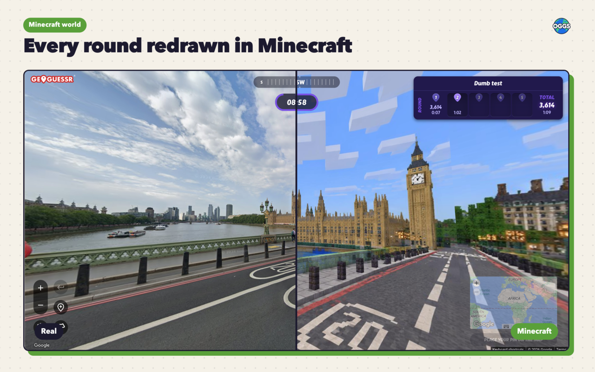
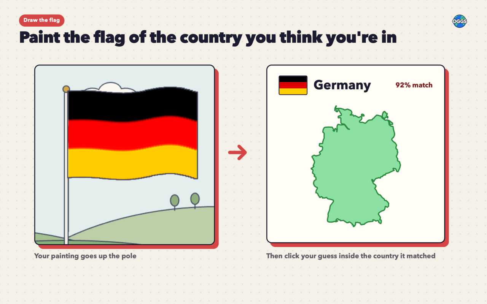
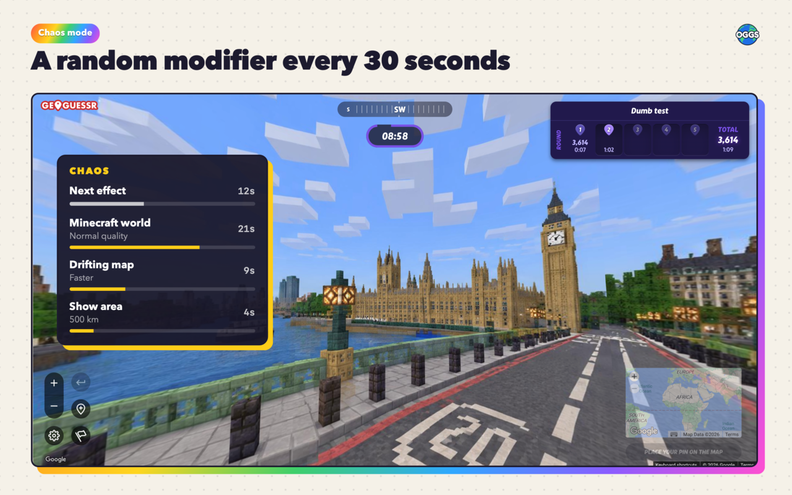

# OGGS: Orlando's GeoGuessr Scripts

> **Status:** v2.0.1, a small project maintained now and then. Live on the Chrome Web Store and as a script for Tampermonkey.

A collection of modifiers for GeoGuessr.

| | |
|---|---|
|  |  |
|  |  |

## Videos

| | |
|---|---|
|  |  |
| **Geoguessr but you have to draw the country you think it is** by JackSucksAtGeography | **Draw the Country to make a Guess vs Jack** by zi8gzag |

## Install

**Chrome extension** (Chrome, Edge, Brave, Opera and other Chromium browsers): [OGGS on the Chrome Web Store](https://chromewebstore.google.com/detail/oggs-orlandos-geoguessr-s/lbnadihehgfemijnjmabooamfnppkkpa).

**Firefox extension:** [OGGS on Firefox Add-ons](https://addons.mozilla.org/firefox/addon/oggs/). (Updated less frequently and not tested).

**Userscript** (for Tampermonkey):

1. Install [Tampermonkey](https://www.tampermonkey.net/) or Violentmonkey. In Chromium browsers, Tampermonkey also needs Developer Mode on (top right of `chrome://extensions`).
2. Open [oggs.user.js](https://raw.githubusercontent.com/Orlando-PB/OGGS/main/userscript/oggs.user.js) and click **Install**.
## Using it

- **Settings:** the OGGS icon in the browser toolbar, or on geoguessr.com the yellow **OGGS** tab at the bottom left (**Alt+O**, Option+O on a Mac).
- **Using OGGS:** The modifiers should work in singleplayer and party duels. It is automatically disabled in competative multiplayer. It's built for fun, not for cheating.
- **Updates** As geoguessr updates, the script may break in certain ways. So far I have found it breaks more in party duels. If it needs fixing, raise an issue or send me a message and I will try to fix it.

## Chaos mode

Adds a modifier lasting 30 seconds at set intervals.
- **Microphone:** Certain modifiers need the microphone to work. If you'd rather not use these, they can be turned off.

## Scripts

### Guessing

| Script | What it does |
|---|---|
| **Draw the country** | The guess map becomes a drawing board. Draw the country you think you're in and pin your spot. It snaps to the closest real country. |
| **Draw the flag** | The guess map becomes a drawing board. Draw the flag, then click your spot in the outline of the country whose flag it matched. |
| **Show latitude / Show longitude** | Shows the lat/long of the round's location. |
| **Show area** | Shows an area around the round's location. |
| **Show distance** | Each pin you drop shows how far it is from the spot. |
| **Terrible hints** | One random hint each round, and half the time it's a lie. |
| **Extra guesses** | Drop several pins. The closest one counts. |
| **Wobbly pin** | Your pin lands somewhere random near where you click. |
| **Ocean only** | You can only guess in the ocean. |
| **Guess in a country** | The whole world is squashed into one country. Guess inside it. |
| **Blind map** | The guess map goes blank. |
| **Drifting map** | The guess map keeps sliding about. |

### Street View

| Script | What it does |
|---|---|
| **Minecraft world** | Redraws the round in Minecraft. |
| **Lying signs** | Rewrites the text on signs in another language or alphabet. |
| **ASCII cam** | Street View drawn in text characters. |
| **Senegal gradient** | Street View melts into a colour gradient. |
| **Ghana black tape** | Adds Ghana's black tape to the car. |
| **Colour filter** | Black and white, inverted, or one colour kept. |
| **Flipped view** | Street View mirrored or upside down. |
| **Spinning view** | Street View slowly spins. |
| **Partial view** | You only see part of Street View. |
| **Blink** | Street View only shows for a moment each round. |
| **Blank screen** | Blacks out everything but the guess map. |
| **Scratch card** | Scratch away foil to see Street View. |
| **Compass lock** | You're stuck facing one direction. |
| **Max zoom** | Street View is stuck fully zoomed in. |

### Misc

| Script | What it does |
|---|---|
| **Radio mode** | Hides Street View. You guess from a live local radio station. |
| **Scream to look** | Street View only shows while you make noise. |
| **Speech jammer** | You hear your own voice slightly late, which makes talking hard. Use headphones. |
| **Lag** | A terrible connection: spinners, freezes, rubber-banding and slow guesses. |

### Controls and UI

| Script | What it does |
|---|---|
| **No move, pan, zoom** | No moving, panning or zooming, each separately. |
| **Inverted controls** | Your controls go the wrong way. |
| **Clean map** | Hides the clutter on the map and screen. |

## Privacy

Everything runs in your browser, and nothing about you or your GeoGuessr account is sent anywhere. What does leave the page:

- **Playing-now count:** while a GeoGuessr tab is open and on screen, an empty request goes to `oggs.orlandopb.com` every two minutes (none in competitive games). It carries no ID, settings or game data. Only the country is worked out from it.
- **Minecraft world** (only when on): the panorama's id and size, a random per-install id and your code (if you entered one) go to `oggs.orlandopb.com`, which fetches the panorama and has it redrawn. The time, that id and your IP address are kept for two days for the daily limits.
- **Radio mode** (only when on): the round's coordinates go to [radio-browser.info](https://www.radio-browser.info) to find stations, and the audio streams from each station's own server.
- **GeoGuessr's own game data** is read with your existing session to know the game mode, map and round. It never leaves your browser.
- **Userscript only:** the drawing boards, country outlines and sign reader are loaded from `oggs.orlandopb.com`.
- **Microphone** (Scream to look, Speech jammer): only measured or played back in the page, never recorded or sent.

The full policy is at [fun.orlandopb.com/oggs_privacy](https://fun.orlandopb.com/oggs_privacy/).

## Help

Something broken? [Open an issue](https://github.com/Orlando-PB/OGGS/issues).

## Credits

Made by Orlando, with AI-assisted code.
