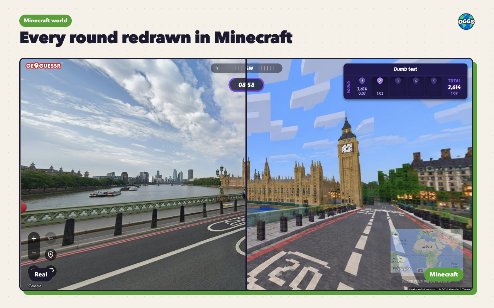
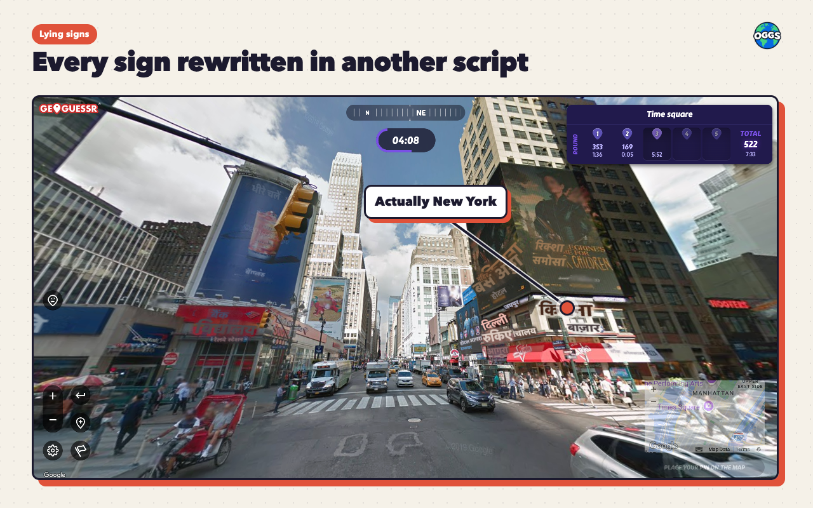
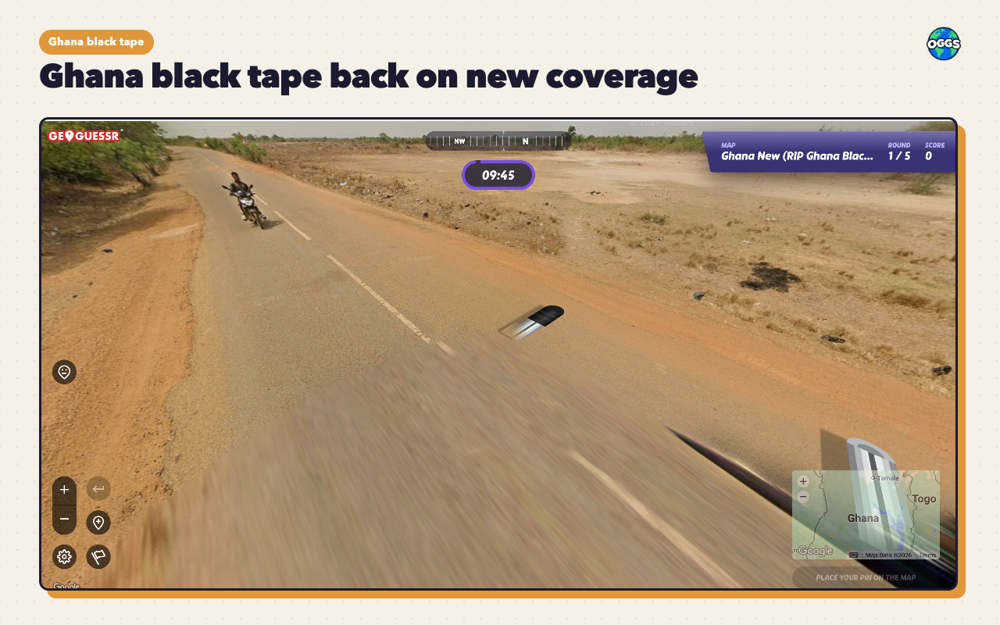
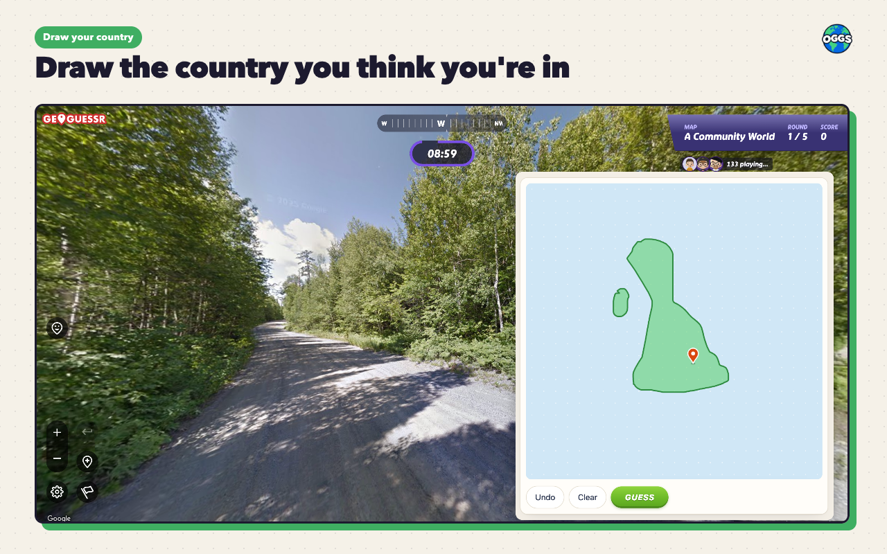
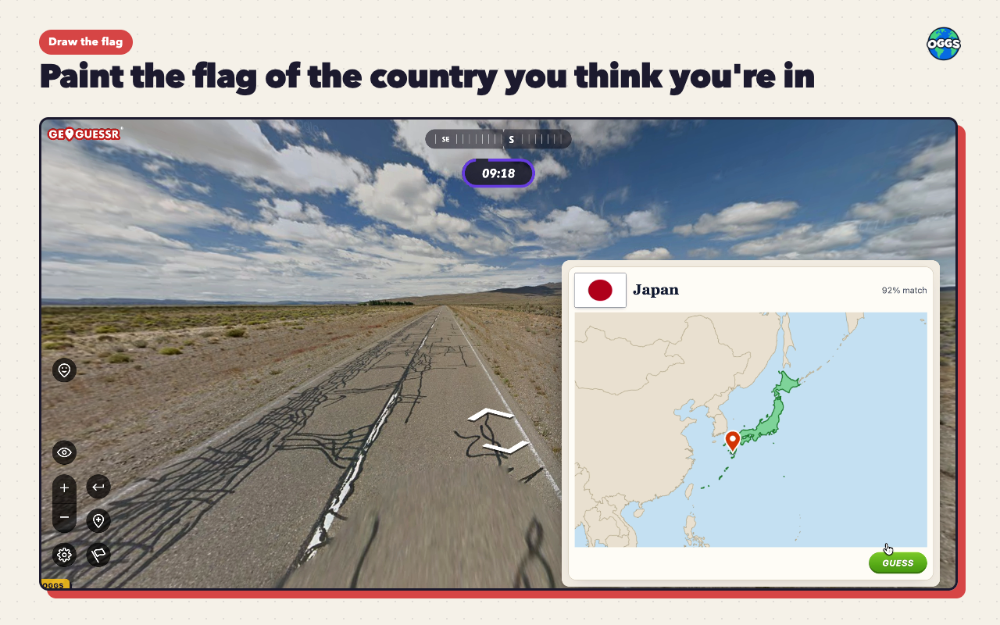
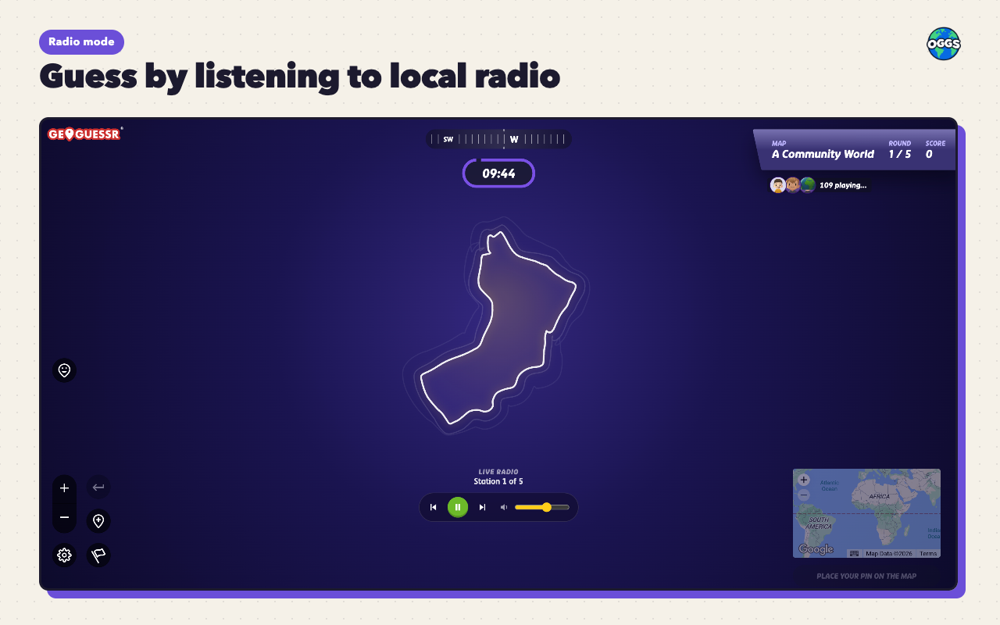

# OGGS: Orlando's GeoGuessr Scripts

> **Status:** a fun side project, maintained now and then. Live on the Chrome Web Store and as a Tampermonkey userscript. Made for singleplayer and games with friends; every script switches itself off in ranked and competitive modes.

A browser extension that bundles a few GeoGuessr scripts. Turn each one on or off from the toolbar popup.

## Install

**Easiest: the Chrome extension.** Works in Chrome, Edge, Brave, Opera and other Chromium browsers.

→ [OGGS on the Chrome Web Store](https://chromewebstore.google.com/detail/oggs-orlandos-geoguessr-s/lbnadihehgfemijnjmabooamfnppkkpa)

Switch scripts on and off from the OGGS icon in the toolbar, or on geoguessr.com from the yellow **OGGS** tab at the bottom left (or **Alt+O**, Option+O on a Mac). Both show the same settings. Recording? Tick *Hide OGGS tab* and use the shortcut.

**Otherwise: the userscript.** For Firefox, or if you already use Tampermonkey.

> Note: the userscript needs a userscript manager such as [Tampermonkey](https://www.tampermonkey.net/). In Chromium browsers (Chrome, Opera, Edge, Brave…) Tampermonkey also needs your browser's Developer Mode switched on. The toggle is at the top right of `chrome://extensions`.

1. Install Tampermonkey (or Violentmonkey).
2. Open [oggs.user.js](https://raw.githubusercontent.com/Orlando-PB/OGGS/main/userscript/oggs.user.js) and click **Install**.
3. On geoguessr.com, settings are behind the yellow **OGGS** tab at the bottom left, or **Alt+O** (Option+O on a Mac).

Updates come automatically in both cases.

## Scripts

**No move, pan, zoom.** Your own NMPZ rules on any game, each of the three separately. In a friendly duel one of you can play NMPZ while the other moves freely.

**Minecraft world.** Redraws the round in Minecraft. Switches on No move, since every new view is a fresh generation; a few high-quality rounds a day.

**Lying signs.** Rewrites the text on Street View signs in another script (Thai, Korean, Cyrillic and more), another language, or Minecraft's enchanting-table glyphs.

**Senegal gradient.** Street View melts into a colour gradient.

**Clean map.** Hides the Terms, Map data and Keyboard shortcuts strips and the Google logo; optionally the GeoGuessr logo and the scoreboard too. Shortcuts still work.

**Add new Ghana black tape.** Paints Ghana's black tape on new Gen 4 coverage, which doesn't have it.

**Draw your country.** Replaces the guess map with a drawing board. Sketch the country you think you're in and pin your spot; it snaps to the closest real country, then zooms out to where you really were.

**Draw the flag.** Replaces the guess map with a paint board. Paint the flag of the country you think you're in, then click your spot in the outline of the country whose flag it matched (by default the guess has to go inside it), and it zooms out to where you really were. Only one of the two drawing boards runs at a time.

**Radio mode.** Hides Street View; you guess from a live radio station near the round's location.

All scripts switch off in competitive modes. They're for fun, not for cheating.

## Privacy

Everything runs in your browser. What does leave the page:

- **Minecraft world:** the panorama id and size, a random per-install id for the daily count and your code (if you entered one) go to `oggs.orlandopb.com`, which fetches the panorama and calls the image API with its own key. The server keeps the time, that id and your IP address for two days, for the daily limits only.
- **Radio mode:** the round's coordinates go to [radio-browser.info](https://www.radio-browser.info) to find stations; the audio streams from each station's own server.
- **GeoGuessr's own API** (with your existing session) is read to tell the game mode, map and round, so scripts can switch off in competitive games.
- **Userscript only:** the drawing boards and the sign-text detector are loaded from `oggs.orlandopb.com`.

Nothing about you or your account is sent anywhere else.

## Help

Something broken? [Open an issue](https://github.com/Orlando-PB/OGGS/issues).
